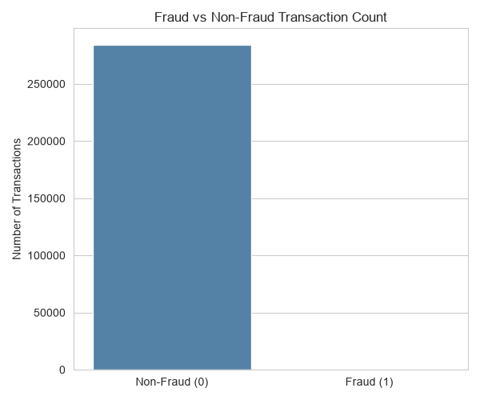
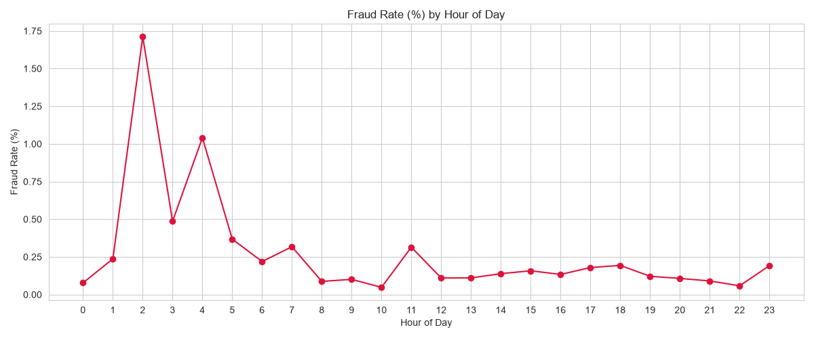
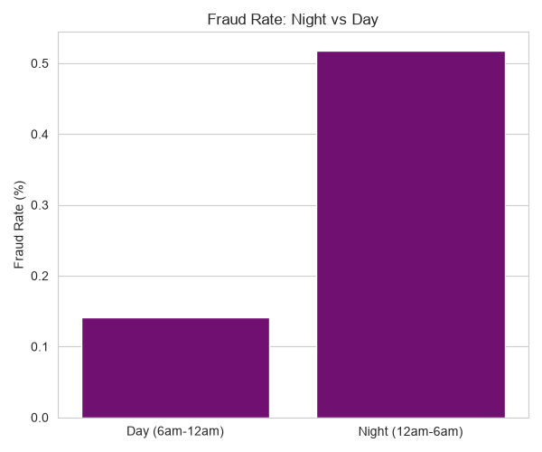
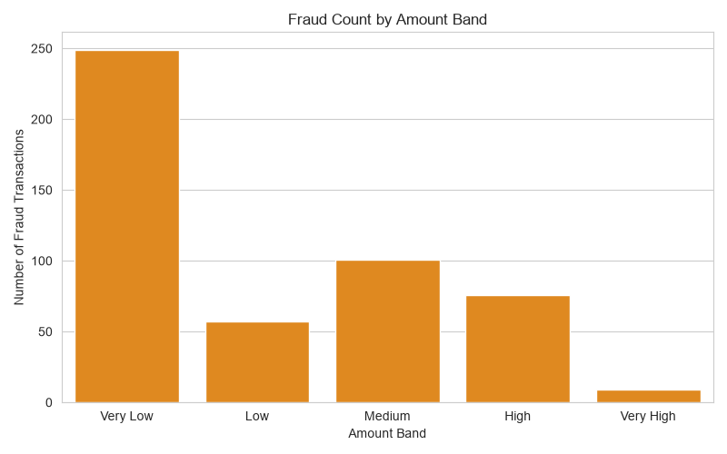

# 💳 Credit Card Fraud Detection: End-to-End Analytics Project

**MySQL · Python (Pandas, Seaborn, Matplotlib) · Power BI**

An end-to-end analytics pipeline on a highly imbalanced credit card transaction dataset: raw data in MySQL → cleaning and feature engineering in Python → exploratory analysis → interactive Power BI dashboard → written report.

## Key Findings

| Metric | Value |
|---|---|
| Transactions analyzed | 284,807 |
| Fraudulent transactions | 492 (**0.173%**) |
| Avg. amount, fraud vs non-fraud | 122.21 vs 88.29 |
| Fraud rate, night (12 AM–6 AM) vs day | **0.52% vs 0.14%** (~3.7x higher at night) |
| Riskiest hour | 2 AM (~1.71% fraud rate) |

- Fraud is extremely rare, so any predictive extension needs imbalance-aware techniques.
- Fraudulent transactions are, on average, larger than normal ones.
- Fraud clusters in the early-morning hours (2 AM, 3 AM, 4 AM).

## Visualizations

| | |
|---|---|
|  |  |
|  |  |

## Workflow

1. **MySQL:** `SQL/Database_Setup.sql` creates the `credit_card_fraud` database, a typed `transactions` table, an `amount_bands` lookup table, and indexes.
2. **Python cleaning:** `Python/extract_and_clean.py` pulls data from MySQL, checks nulls/duplicates, and engineers features (scaled and log amount, hour of day, night flag, amount bands).
3. **EDA:** `Python/fraud_eda_visualizations.py` produces the charts in `Visualizations/`.
4. **SQL analysis:** `SQL/Analysis_Queries.sql` holds the fraud-pattern queries.
5. **Power BI:** the dashboard (see note below) and a written report in `Report/`.

## Folder Structure

```
Project_1_Credit_Card_Fraud/
├── SQL/             Database_Setup.sql, Analysis_Queries.sql
├── Python/          extract_and_clean.py, fraud_eda_visualizations.py
├── Visualizations/  exported charts (PNG)
├── PowerBI/         dashboard (see note)
├── Report/          Fraud_Detection_Report_Karan_Bisht.docx
├── Dataset/         (data files not stored here, see below)
└── README.md
```

## Dataset

Kaggle **Credit Card Fraud Detection** dataset (`creditcard.csv`). It is too large for GitHub, so download it from Kaggle and place it in `Dataset/`. `transactions_cleaned.csv` is regenerated by the Python script.

## How to Reproduce

```bash
pip install -r requirements.txt
# copy .env.example to .env and fill in your MySQL username and password
```

1. Run `SQL/Database_Setup.sql` in MySQL, then load `creditcard.csv` into the `transactions` table.
2. `python Python/extract_and_clean.py`
3. `python Python/fraud_eda_visualizations.py` (run from the folder containing `transactions_cleaned.csv`)
4. Open the Power BI dashboard and refresh it against your data.

## Author

**Karan Bisht**: aspiring Data Analyst (SQL · Python · Power BI)
